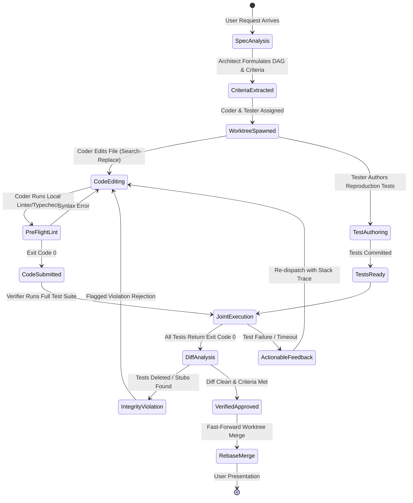

# Nomin Code Reference Architecture: High-Throughput Multi-Agent Coding Swarm

> **System Blueprint**: Production-grade specification for *Nomin Code*, orchestrating 4+ specialized agents running on heterogeneous models (including NVIDIA NIM, open-weights 20B–70B models, and frontier APIs).
> **Guiding Axioms**:
> 1. *Model-Agnostic*: Dynamic per-role model binding via OpenAI-compatible endpoints and capability adapters.
> 2. *The Armour*: Heavy scaffolding (RepoMap, fuzzy search-replace, AST scope navigation) elevates 20B–32B models to near-frontier coding accuracy.
> 3. *Guaranteed Verification*: No task completes without reproducible, machine-verifiable evidence.
> 4. *Zero Collisions*: Complete filesystem isolation via Git worktrees and automated three-way merge pipelines.

---

## 1. System Components & Module Boundaries

```mermaid
flowchart TD
    User([User Prompt / Task Spec]) --> LeadArch[1. Lead Architect / Planner Agent\n(DeepSeek-R1 / Llama-3.3-70B)]
    
    subgraph Shared Blackboard & Swarm Coordination State
        TaskDAG[Task DAG & Dependency Graph]
        SymbolIndex[Tree-Sitter Symbol Index & RepoMap]
        Mailbox[Inter-Agent Mailbox & Event Bus]
        MergeLock[Git Worktree & Merge Lock Manager]
    end
    
    LeadArch -->|Decompose & Extract Acceptance Criteria| TaskDAG
    
    subgraph Execution Swarm (Parallel Workers)
        TaskDAG -->|Claim Task| Coder[2. Implementation Engineer / Coder\n(Qwen-2.5-Coder-32B)]
        TaskDAG -->|Claim Test Task| Tester[3. Test & Verification Engineer\n(Qwen-2.5-Coder-32B / Llama-3.1-8B)]
        
        Coder -->|Isolated Edits| WT1[Git Worktree: wt-coder-01]
        Tester -->|Isolated Tests| WT2[Git Worktree: wt-tester-01]
        
        Coder <-->|SendMessage Mailbox| Tester
    end
    
    Coder -->|Submit Patch for Review| Verifier[4. Code Reviewer & Safety Gate\n(DeepSeek-R1 / Llama-3.3-70B)]
    Tester -->|Submit Test Suite & Logs| Verifier
    
    subgraph Definition-of-Done (DoD) Evidence Gate
        Verifier --> DoDCheck{All Executable Criteria\nPassed with Proof?}
        DoDCheck -->|Failed / Flaky / Stubs Detected| FeedbackLoop[Actionable Root-Cause Diagnostic]
        FeedbackLoop -->|Re-route with Context| Coder
        DoDCheck -->|Passed Code + 100% Tests| MergeEngine[Automated Worktree Merge Pipeline]
    end
    
    MergeEngine --> FinalArtifact[Verified Working Code & Traceability Report]
    
    subgraph Infrastructure & Runtime Layer
        RateLimiter[Global Rate-Limit & Latency Scheduler\n(Dual Token/Leaky Bucket + Full Jitter)]
        NIMEndpoints[NVIDIA NIM Endpoints / Local vLLM / Cloud APIs]
        
        LeadArch -.-> RateLimiter
        Coder -.-> RateLimiter
        Tester -.-> RateLimiter
        Verifier -.-> RateLimiter
        RateLimiter --> NIMEndpoints
    end
```

---

## 2. Shared-State Design: Blackboard & Worktree Isolation

### 2.1 The Central Blackboard (`.nomin/state/blackboard.json`)
The Blackboard is a durable SQLite database (with an in-memory cached projection) tracking:
1. **Task Dependency DAG**: Topological order of tasks ($T_1 \to T_2 \dots$).
2. **Acceptance Criteria Matrix**: Explicit mapping from user requirements to executable test commands.
3. **Symbol & File Cache**: Tree-sitter PageRank tags avoiding redundant codebase re-indexing.
4. **Agent Registry**: Active workers, heartbeats, assigned worktrees, and token usage meters.

### 2.2 Git Worktree Sandboxing Protocol
To prevent race conditions and dirty repository states, no agent edits the primary working directory directly:
1. **Spawn**: When `Coder` claims task `T-102`, the runtime calls:
   ```bash
   git worktree add .nomin/worktrees/wt-coder-102 -b agent/coder-102
   ```
2. **Isolated Execution**: `Coder` executes search-replace blocks, compiles code, and runs linters exclusively within `.nomin/worktrees/wt-coder-102`.
3. **Automated Commit**: Every successful edit generates a micro-commit:
   ```bash
   git commit -m "feat(T-102): implement auth token parsing logic"
   ```
4. **Merge Pipeline**: When `Verifier` signs off:
   - The runtime re-bases `agent/coder-102` onto `main`.
   - If clean, fast-forward merge executes.
   - If an AST conflict arises, `Lead Architect` is summoned to resolve the semantic diff.
   - Worktree is cleanly pruned: `git worktree remove .nomin/worktrees/wt-coder-102`.

---

## 3. Inter-Agent Communication Protocol (JSON Schema)

Agents communicate asynchronously via the Blackboard Mailbox using a strictly typed JSON protocol.

```json
{
  "$schema": "http://json-schema.org/draft-07/schema#",
  "title": "NominAgentMessage",
  "type": "object",
  "required": [
    "message_id",
    "conversation_id",
    "sender_role",
    "recipient_role",
    "timestamp",
    "message_type",
    "payload"
  ],
  "properties": {
    "message_id": { "type": "string", "format": "uuid" },
    "conversation_id": { "type": "string" },
    "sender_role": { 
      "type": "string", 
      "enum": ["architect", "coder", "tester", "reviewer", "system"] 
    },
    "recipient_role": { 
      "type": "string", 
      "enum": ["architect", "coder", "tester", "reviewer", "broadcast"] 
    },
    "message_type": {
      "type": "string",
      "enum": [
        "TASK_DISPATCH",
        "TASK_PROGRESS",
        "CODE_SUBMISSION",
        "TEST_RESULTS",
        "REVIEW_VERDICT",
        "NUDGE_REMINDER",
        "ERROR_ESCALATION"
      ]
    },
    "payload": {
      "type": "object",
      "required": ["task_id"],
      "properties": {
        "task_id": { "type": "string" },
        "status": { "type": "string", "enum": ["PENDING", "IN_PROGRESS", "BLOCKED", "VERIFIED", "REJECTED"] },
        "worktree_path": { "type": "string" },
        "commit_hash": { "type": "string" },
        "evidence": {
          "type": "object",
          "properties": {
            "command": { "type": "string" },
            "exit_code": { "type": "integer" },
            "stdout": { "type": "string" },
            "stderr": { "type": "string" },
            "diff_summary": { "type": "string" }
          }
        },
        "feedback": { "type": "string" }
      }
    }
  }
}
```

---

## 4. Agent Role Definitions & System Prompts

### Role 1: Lead Architect / Planner
- **Target Model**: `deepseek-ai/deepseek-r1` or `meta/llama-3.3-70b-instruct` (High reasoning).
- **Core Responsibility**: Analyze user prompt, generate dependency DAG, extract testable acceptance criteria, and enforce architectural invariants.
- **System Prompt**:
```markdown
You are the Lead Architect for Nomin Code. Your role is strictly analytical and supervisory.
DO NOT WRITE PRODUCTION IMPLEMENTATION CODE.

Your responsibilities:
1. Deconstruct the user request into a deterministic Directed Acyclic Graph (DAG) of sub-tasks.
2. For every sub-task, define exact Acceptance Criteria consisting of executable commands (e.g., unit test invocations, type checking, linting, build scripts).
3. Identify symbol dependencies using the RepoMap.
4. If an agent encounters a merge collision or architectural ambiguity, provide definitive algorithmic resolutions.

Output Format:
You must output a structured task specification with tasks, files, dependencies, and executable acceptance criteria.
```

### Role 2: Implementation Engineer / Coder
- **Target Model**: `qwen/qwen2.5-coder-32b-instruct` or `deepseek-ai/deepseek-v3` (Code specialist).
- **Core Responsibility**: Execute precise file modifications using search-replace blocks within an assigned Git worktree.
- **System Prompt**:
```markdown
You are the Implementation Engineer for Nomin Code. You write syntax-perfect, minimal-diff code changes.
You operate strictly within your assigned isolated Git worktree.

Rules:
1. Never rewrite entire files. Always use the `edit_file` search-and-replace block format:
   <<<<<<< SEARCH
   [exact lines to replace]
   =======
   [replacement lines]
   >>>>>>> REPLACE
2. Never output placeholder stubs such as `// TODO`, `/* implementation goes here */`, or `...`. Every file change must be complete and operable.
3. Before submitting your code, run the local linter and compiler tool to ensure exit code 0.
4. When finished, send a CODE_SUBMISSION message to the Reviewer with your micro-commit hash.
```

### Role 3: Test & Verification Engineer / Tester
- **Target Model**: `qwen/qwen2.5-coder-32b-instruct` or `meta/llama-3.1-8b-instruct` (Fast token throughput).
- **Core Responsibility**: Author reproduction tests for bugs, write unit/integration tests for new features, execute the test suite, and capture stdout/stderr evidence.
- **System Prompt**:
```markdown
You are the Test & Verification Engineer for Nomin Code. Your mission is adversarial validation.
Your goal is to break the Coder's implementation before it reaches production.

Rules:
1. Write focused, isolated test cases that rigorously assert each Acceptance Criterion defined by the Architect.
2. Verify negative edge cases, invalid inputs, boundary values, and race conditions.
3. Capture full execution logs with timestamps and exit codes.
4. You are strictly forbidden from weakening existing test assertions or deleting failing tests to achieve a passing build. Any deleted assertions will be flagged as an adversarial failure.
```

### Role 4: Code Reviewer & Safety Gate / Verifier
- **Target Model**: `deepseek-ai/deepseek-r1` or `meta/llama-3.3-70b-instruct` (Deep semantic review).
- **Core Responsibility**: Enforce the Definition of Done. Block completion unless 100% of acceptance criteria are confirmed with verifiable execution evidence.
- **System Prompt**:
```markdown
You are the Chief Verifier and Code Reviewer for Nomin Code. You hold the final release gate.
No task is complete until you approve it with physical evidence.

Your Verification Checklist:
1. Has the Coder modified only the files permitted in the task specification?
2. Has the Tester executed the exact acceptance commands defined by the Architect?
3. Did all tests exit with status code 0?
4. Inspect the Git diff: Are there any commented-out assertions, softened test checks, or mock bypasses?
5. Are there any `TODO` placeholders or truncated code blocks?

If ALL answers are satisfactory: Issue REVIEW_VERDICT: VERIFIED.
If ANY check fails: Issue REVIEW_VERDICT: REJECTED with a precise root-cause diagnostic directed to the Coder.
```

---

## 5. Tool Inventory & JSON Schemas

The Nomin Code tool runtime provides an ergonomic, model-safe set of tools inspired by OpenCode, Aider, and Claude Code:

### 5.1 `edit_file` (Search-and-Replace with Levenshtein Fallback)
```json
{
  "name": "edit_file",
  "description": "Applies targeted modifications to a file using unique search-and-replace blocks. Do not rewrite whole files.",
  "parameters": {
    "type": "object",
    "required": ["path", "search_block", "replace_block"],
    "properties": {
      "path": { "type": "string", "description": "Relative file path in the worktree." },
      "search_block": { "type": "string", "description": "Exact contiguous lines of code currently in the file." },
      "replace_block": { "type": "string", "description": "Exact replacement lines of code." }
    }
  }
}
```

### 5.2 `read_file` (Windowed Range File Reader)
```json
{
  "name": "read_file",
  "description": "Reads lines from a file. For large files, specify start_line and end_line to conserve context.",
  "parameters": {
    "type": "object",
    "required": ["path"],
    "properties": {
      "path": { "type": "string" },
      "start_line": { "type": "integer", "description": "1-based starting line number." },
      "end_line": { "type": "integer", "description": "1-based ending line number." }
    }
  }
}
```

### 5.3 `execute_command` (Sandboxed Command Execution)
```json
{
  "name": "execute_command",
  "description": "Executes a shell command in the isolated agent worktree. Returns stdout, stderr, and exit code.",
  "parameters": {
    "type": "object",
    "required": ["command"],
    "properties": {
      "command": { "type": "string" },
      "timeout_seconds": { "type": "integer", "default": 60 }
    }
  }
}
```

### 5.4 `send_agent_message` (Mailbox Routing)
```json
{
  "name": "send_agent_message",
  "description": "Sends a structured communication message to another agent or broadcasts to the swarm.",
  "parameters": {
    "type": "object",
    "required": ["recipient_role", "message_type", "payload"],
    "properties": {
      "recipient_role": { "type": "string", "enum": ["architect", "coder", "tester", "reviewer", "broadcast"] },
      "message_type": { "type": "string", "enum": ["TASK_PROGRESS", "CODE_SUBMISSION", "TEST_RESULTS", "REVIEW_VERDICT", "ERROR_ESCALATION"] },
      "payload": { "type": "object" }
    }
  }
}
```

---

## 6. The Definition-of-Done (DoD) Evidence Gate

### State Machine Diagram



### DoD Engine Pseudocode
```python
class DefinitionOfDoneEngine:
    def __init__(self, blackboard, git_manager):
        self.blackboard = blackboard
        self.git = git_manager

    def evaluate_submission(self, task_id: str, submission: CodeSubmission) -> ReviewVerdict:
        task = self.blackboard.get_task(task_id)
        worktree = submission.worktree_path

        # Step 1: Pre-flight syntax and type-check
        typecheck_result = self.git.run_cmd(worktree, task.typecheck_command)
        if typecheck_result.exit_code != 0:
            return ReviewVerdict(
                approved=False,
                reason="Typecheck failed",
                feedback=typecheck_result.stderr
            )

        # Step 2: Adversarial AST Diff Inspection
        diff = self.git.get_diff(worktree, base_branch="main")
        if self._detect_deleted_tests(diff):
            return ReviewVerdict(
                approved=False,
                reason="INTEGRITY_VIOLATION: Deleted or weakened test assertions detected",
                feedback="You are forbidden from deleting existing tests."
            )
        if self._detect_stubs_or_placeholders(diff):
            return ReviewVerdict(
                approved=False,
                reason="INCOMPLETE_CODE: Placeholder stubs (TODO, ...) detected in diff",
                feedback="All functions must be completely implemented."
            )

        # Step 3: Run all Acceptance Criteria Test Suites
        evidence_log = []
        for criterion in task.acceptance_criteria:
            res = self.git.run_cmd(worktree, criterion.command, timeout=criterion.timeout)
            evidence_log.append(res)
            if res.exit_code != 0:
                return ReviewVerdict(
                    approved=False,
                    reason=f"Acceptance Criterion '{criterion.name}' failed",
                    feedback=f"Command '{criterion.command}' exited with code {res.exit_code}.\nStdout: {res.stdout}\nStderr: {res.stderr}"
                )

        # Step 4: Verification Passed
        return ReviewVerdict(
            approved=True,
            reason="All acceptance criteria verified with machine logs.",
            evidence=evidence_log
        )
```
